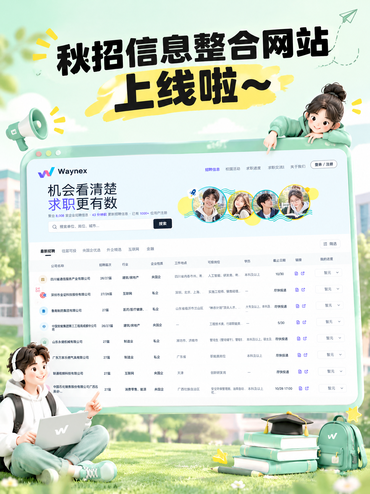
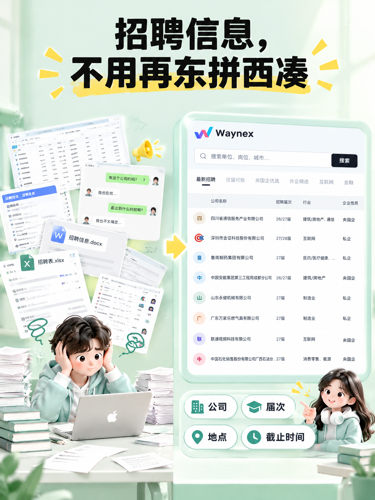
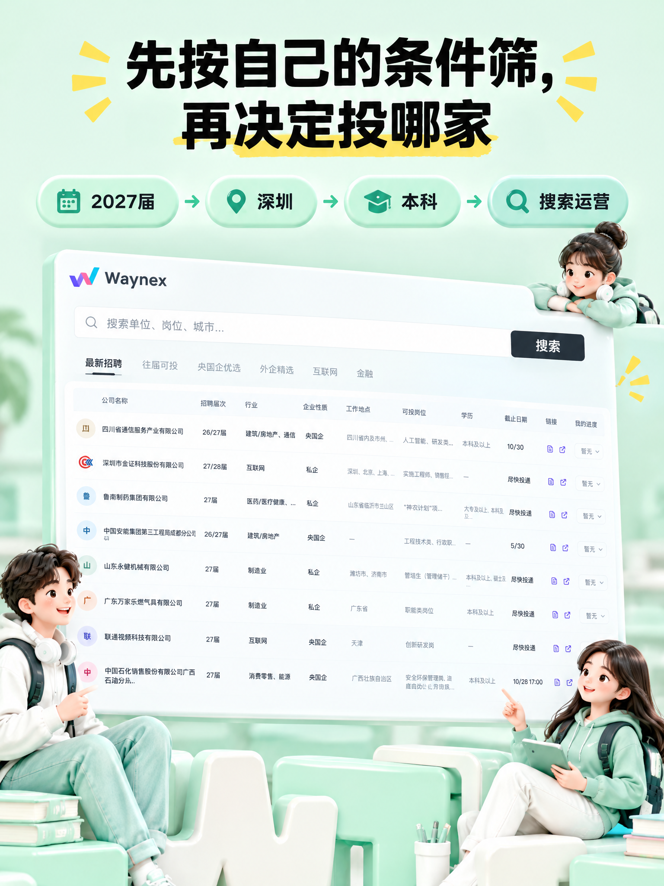
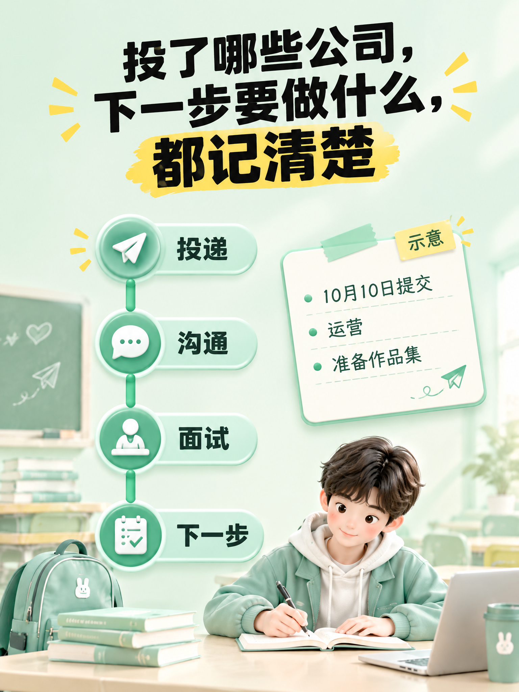

  

<h1 align="center">Waynex · 机会看清楚，求职更有数</h1>

把分散的招聘信息、校园活动和个人求职进度放到一起。 让大学生少花时间找信息，多花时间准备求职。

<strong>立即使用：</strong>

**Waynex 是面向大学生的校招信息聚合与求职进度管理平台。** 集中整理招聘公告、企业宣讲会和校园招聘会，支持条件筛选、活动日历与投递看板，帮助在校生和应届毕业生发现机会、核对要求并持续跟进求职。

   ·
   ·
   ·
  <a href="docs/student-guide.md">学生使用指南</a>

## 为什么做 Waynex

找工作已经很难，找到招聘信息也不该这么累。

一条校招公告可能在公众号里，另一条在企业官网里；宣讲会安排在高校就业网上，投递入口又在另一个招聘系统里。你需要反复搜索、打开网页、核对届次和地点，还得记住哪些投过、哪些要跟进。

Waynex 面向正在准备校招的在校生和应届毕业生，也方便符合公告条件的往届生查找机会。我们整理公众号、企业官方招聘渠道与高校就业平台的公开信息，把常用条件、来源入口、校园活动和个人记录集中到一个地方，减少重复查找与整理。

## 可以帮你做到什么程度

从发现机会、初步筛选、核对公告，到找到投递渠道、记录求职阶段，Waynex 可以帮你把这些步骤连起来；投递提交、笔面试准备和最终选择仍由你完成。

| 你遇到的问题 | Waynex 提供的帮助 |
| --- | --- |
| 招聘信息散在多个网站和公众号 | 集中浏览已收录的招聘项目，搜索单位、岗位或城市 |
| 每条公告都要打开才能初步判断 | 在列表比较招聘届次、行业、企业性质、工作地点、可投岗位、学历和截止信息 |
| 信息太多，不知道先看哪些 | 按毕业届次、地点、学历、行业、性质筛选；按最新更新或即将截止排序 |
| 找到了机会，却找不到报名入口 | 从“校招公告”“投递渠道”或“报名说明”查看来源与申请方式 |
| 不知道哪里有宣讲会、招聘会 | 浏览校园活动，按活动类型、举办高校、省份和时间筛选，查看活动安排及已收录的参会名单 |
| 想参加的活动散在聊天记录里 | 登录后关注活动，在“我的关注”和个人活动日历里集中查看 |
| 投得多，忘了哪家到了哪一步 | 用看板或表格管理求职进度，维护阶段和个人备注 |
| 电脑整理完，手机又要找一遍 | 同一账号在电脑网页与手机网页读取已保存的进度、备注、资料和活动关注 |

### 找机会，也能安排下一步

招聘页提供“最新招聘、往届可投、央国企优选、外企精选、互联网、金融”等快捷分类。选中感兴趣的招聘项目后，可以标记自己的进度：

**待投递 → 已投递 → 笔试 → 一面 → 二面 → 更多面 → 已 Offer / 未通过**

阶段由你选择，不要求逐级填写。可以在备注里记录具体岗位、面试安排或下一步待办；校园活动则通过关注和日历单独管理，方便安排线下求职行程。

## 三步开始使用

1. **打开 [waynex.lincolab.com](https://waynex.lincolab.com/)**：公开招聘与校园活动列表可直接浏览，用关键词和筛选条件缩小范围。
2. **核对原始公告并完成投递**：确认专业、届次、地点、截止时间与报名材料，按照招聘单位要求提交申请。
3. **登录并记录下一步**：把感兴趣的项目标记为“待投递”，提交后确认“已投递”；更新阶段、保存备注，关注想参加的校园活动。

更具体的操作示例见 [学生使用指南](docs/student-guide.md)，能力范围见 [产品能力与边界](docs/capabilities.md)。

## 常见问题

### 大学生去哪里集中找校招信息？

可以在 [Waynex 招聘信息页](https://waynex.lincolab.com/) 集中查找已收录的校招公告，搜索单位、岗位或城市，并比较招聘届次、工作地点、学历和截止信息。信息来自公众号、高校就业平台和企业官方招聘渠道，具体报名要求以原始公告为准。

### 如何按自己的条件筛选招聘机会？

在招聘页选择毕业届次、工作地点、学历、行业和企业性质，再结合岗位关键词缩小范围。地点、行业和性质支持多选；筛选用于初步查找，具体专业、资格和岗位要求仍需逐项核对原始公告。

### 如何查询企业宣讲会和校园招聘会？

在 [校园活动页](https://waynex.lincolab.com/campus) 按活动类型、举办高校、省份和时间查找宣讲会、招聘会及其他就业活动。查看详情时按页面提示登录，核对时间、地点、参与方式和公告；有参会名单时可以查阅已收录的单位。

### 有没有能记录投递和面试进度的工具？

Waynex 的 [求职进度](https://waynex.lincolab.com/me) 提供看板和表格视图，可记录待投递、已投递、笔试、面试、Offer 和未通过等阶段，并保存具体岗位或下一步待办的备注。当前按招聘项目管理，由本人更新阶段；同一账号可在电脑和手机网页读取已保存的数据。

### 可以把感兴趣的招聘活动放进日历吗？

登录后关注校园活动，有明确日期的活动会显示在个人活动日历中，也可以通过“我的关注”集中查看。关注用于整理日程，不代表已经报名或开启自动提醒；参会仍需按照活动公告要求完成。

### Waynex 可以自动投递简历吗？

当前不提供自动投递。Waynex 帮助你找到公告、投递渠道或报名说明，简历与材料需要本人在招聘单位指定渠道提交；打开入口不会自动记为已投递，提交后需要本人确认进度。

### 使用 Waynex 需要登录吗？

公开招聘与校园活动列表可直接浏览。记录求职进度、保存备注、关注活动和查看需要登录的活动详情时，按网站提示登录；同一账号可跨设备读取已成功保存的个人数据。

## 信息来源与核对

Waynex 整理的公开信息主要来自以下渠道：

- **企业官网与官方招聘渠道**：招聘公告、岗位信息和申请入口。
- **高校就业平台**：校招公告、企业宣讲会、招聘会及已发布的参会名单。
- **公众号文章**：公开发布的招聘公告和报名说明，保留可用来源链接供核对。

来源覆盖与整理进度会变化，不承诺全网收录或实时更新。没有可靠依据的条件不猜填；数据整理方式与使用边界见 [产品能力与边界](docs/capabilities.md)。

## 图解 Waynex

下图展示招聘信息页的整体使用场景，点击可进入官网。

  

<strong>展开查看 6 张产品宣传图：信息聚合、条件筛选、校园活动与求职进度</strong>

<table>
  <tr>
    <td width="50%" align="center">
       
      <strong>招聘信息集中看</strong>
    </td>
    <td width="50%" align="center">
       
      <strong>先筛条件，再决定投哪家</strong>
    </td>
  </tr>
  <tr>
    <td width="50%" align="center">
       
      <strong>校园活动纳入日程</strong>
    </td>
    <td width="50%" align="center">
       
      <strong>投了哪些，下一步做什么</strong>
    </td>
  </tr>
  <tr>
    <td width="50%" align="center">
       
      <strong>少花时间整理秋招信息</strong>
    </td>
    <td width="50%" align="center">
       
      <strong></strong>
    </td>
  </tr>
</table>

图中界面与数据为展示示意，限时免费活动以官网当前说明为准。点击功能图可查看原图，点击体验邀请可直接进入 [Waynex 官网](https://waynex.lincolab.com/)。

## 关于信息和使用范围

- **覆盖已收录的公开信息**：收录范围与更新进度会变化，Waynex 不承诺覆盖所有企业、学校或平台。最新要求以原始公告和招聘单位通知为准。
- **保留来源，方便核对**：没有可靠依据的条件不猜填；空白或“—”表示未知，不代表“不限”。不同岗位可能有不同要求。
- **投递需要本人完成**：打开投递渠道不等于已经提交。Waynex 不代投简历，求职阶段由本人记录；当前按招聘项目管理进度，同一项目下多个岗位不分别记录。
- **关注活动用于整理日程**：关注不代表已报名，也不代表已开启自动提醒。当前介绍不包含 AI 个性化推荐、自动投递或自动提醒服务。

## 文档与更新

- [学生使用指南](docs/student-guide.md)：筛选、投递、活动关注与进度记录的操作示例。
- [产品能力与边界](docs/capabilities.md)：当前模块、信息来源与适用范围。
- [公开介绍更新记录](docs/updates.md)：带日期的文档与素材更新，不作为产品发布或数据更新记录。

## 一起把求职信息整理得更好

如果你觉得 Waynex 有用，欢迎把 [网站地址](https://waynex.lincolab.com/) 分享给正在找工作的同学，也欢迎 Star 本仓库。

使用问题、信息纠错和改进建议，可通过网站的 [帮助中心](https://waynex.lincolab.com/help) 提交反馈。产品建议也欢迎在 [GitHub Issues](https://github.com/lincotalk/linco-waynex/issues) 交流；请勿在公开 Issue 中提交简历、手机号、验证码或个人求职记录。

企业招聘团队、高校就业部门和学生组织，可查看 [企业合作](https://waynex.lincolab.com/cooperation)。

本仓库用于 Waynex 的公开产品介绍、使用说明与交流。Waynex 由 **Linco lab 旗下的 Waynex 产品团队**开发与维护，具体开放功能以网站实际展示为准。
